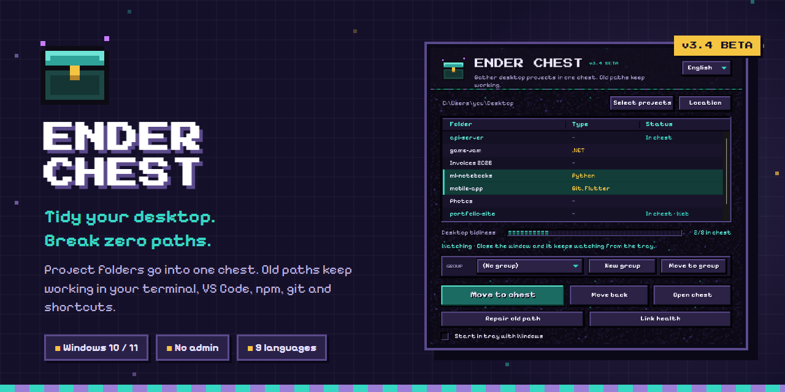
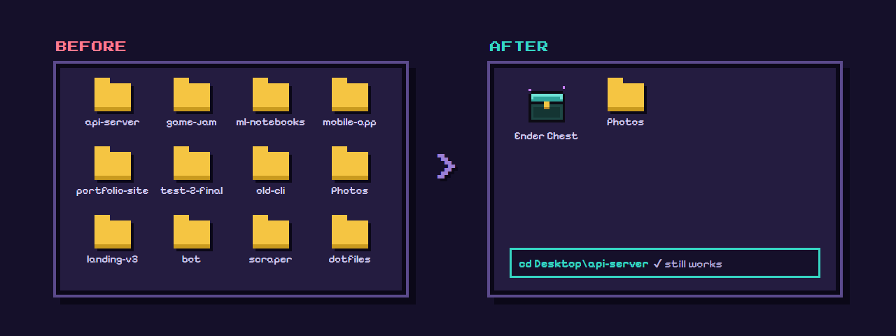
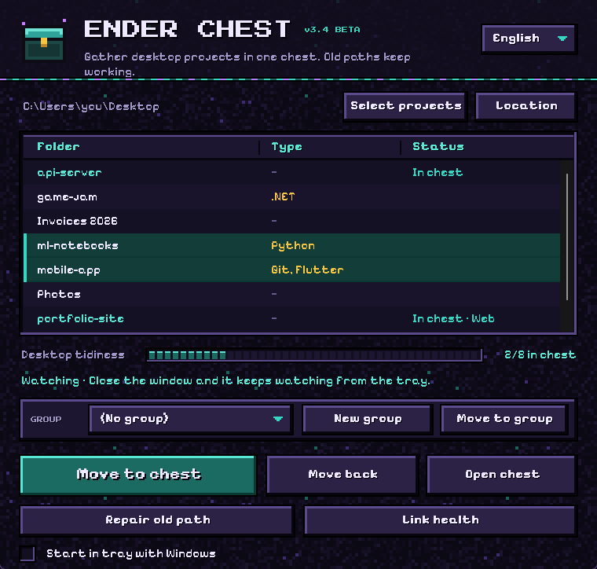
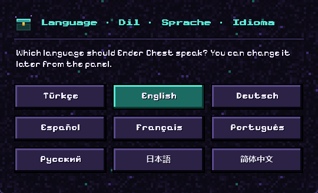
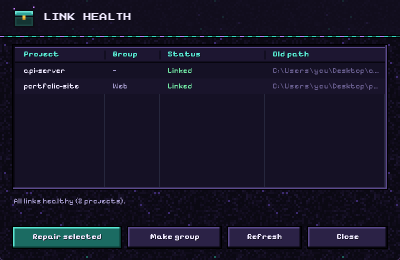
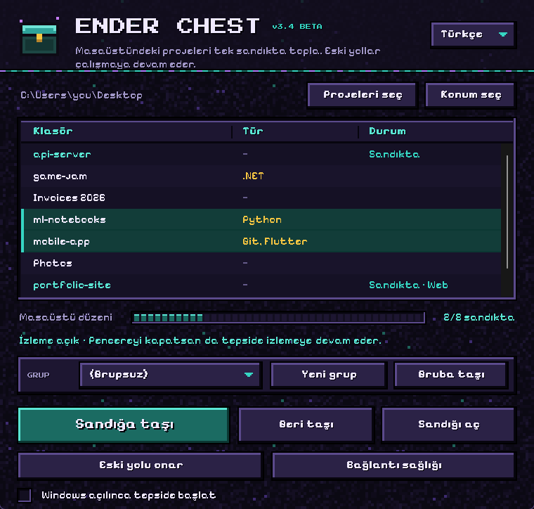

<div align="center">



# Ender Chest

**Clean up your Windows desktop without breaking a single path.**

Move project folders into one chest. Every old path (`C:\Users\you\Desktop\my-app`) keeps working —
terminals, VS Code, npm, git and shortcuts never notice the move.

[](https://github.com/xkudcobi/ender-chest/releases/latest)
[](https://github.com/xkudcobi/ender-chest/stargazers)
[](https://github.com/xkudcobi/ender-chest/actions/workflows/windows.yml)


[Türkçe](#türkçe) · [How it works](#how-it-works) · [Safety](#safety) · [Languages](#languages) · [Development](#development)



</div>

## Quick start

1. **[Download the latest ZIP](https://github.com/xkudcobi/ender-chest/releases/latest)** and extract it.
2. Double-click **`Install.cmd`**. No admin rights needed.
3. Click **Select projects**, then **Move to chest**. Done: your desktop is clean and every old path still opens.

> If Ender Chest saves you from desktop chaos, a ⭐ helps other developers find it.

<p align="center"></p>

---

## Why

A developer desktop fills up fast: `portfolio-site`, `api-server`, `test-2-final`… Moving them breaks
terminal history, IDE recent lists, scripts and shortcuts that point at the old path.
Ender Chest moves the real folder into `Desktop\Ender Chest` and leaves a **hidden NTFS junction** at the
old location, so both paths open the same files.

## Features

- **One-click tidy-up** — detects project folders (Node, Git, .NET, Python, Go, Rust, Java, PHP, Ruby, Flutter, Web) and moves them in bulk; exclude anything you want to keep on the desktop.
- **Old paths keep working** — hidden junctions, no copying; moves on the same drive are instant.
- **Groups** — organise the chest into `Web`, `Tools`, `Archive`…; drag projects between groups in Explorer and the links follow automatically.
- **Explorer-native** — drop a folder into the chest in Explorer and Ender Chest links it; rename or regroup inside the chest and it re-points the link by folder identity.
- **Link health** — finds visible, missing or broken links and repairs them.
- **Crash-safe** — every move is journaled; an interrupted move is completed on next start.
- **Lives in the tray** — optional start with Windows, single instance, balloon notices.
- **9 languages**, asked on first start.
- **Pixel "End" theme** — an original blocky design with pixel fonts.

<p align="center">
  
  
</p>

## Install

1. Download the ZIP from Releases and extract it.
2. Double-click **`Install.cmd`** (no admin rights needed).
3. Ender Chest starts and asks for your language. It is installed to `%LOCALAPPDATA%\Programs\Ender Chest`
   with a Start menu entry and a desktop shortcut. Pin it to the taskbar from the Start menu if you like.

Uninstall with `tools\Uninstall.ps1` — your chest, projects and links stay exactly as they are.

## How it works

```
Desktop\
├── my-app          ← hidden junction  ─┐   (old path still opens)
└── Ender Chest\                        │
    └── Web\                            │
        └── my-app  ← the real folder ◄─┘
```

- Moves use `Directory.Move` on the same NTFS volume (a rename — no copying, no partial files).
- A junction is created at the old path and marked hidden + system, so the desktop stays clean.
- Folders are recognised by **volume serial + file ID + creation time**, so renames and Explorer moves are tracked reliably.
- State lives in the hidden `Ender Chest\.enderchest` folder (`projects.json`, `index.json`, `settings.json`, `pending-*.json`).

## Safety

- Nothing is ever overwritten or merged. If a name is taken, the move does not start.
- A folder that is in use (open file, terminal, dev server) cancels the move **without changing anything**, and the app tells you which programs may be using it.
- Every move / move-back is journaled first; interrupted operations are finished on the next start.
- Requires a local NTFS drive. OneDrive-synced desktops are not supported.
- Delete desktop junctions only with Explorer. Some tools (old `rmdir /s`, `Remove-Item -Recurse` in PowerShell 5.1, cleaners) follow junctions and delete the real files.

## Languages

Türkçe · English · Deutsch · Español · Français · Português · Русский · 日本語 · 简体中文

Change it any time from the selector in the top-right corner. To add a language, copy the `$Strings.en`
table in [`Lang.ps1`](Lang.ps1), translate the values, add its native name to `$Languages` and run
`./EnderChest.ps1 -LangTest` — it checks keys, `{0}` placeholders and pixel-font glyph coverage.

## Development

| File | What it does |
|---|---|
| `EnderChest.ps1` | App: moves, journal, UI, tray, tests |
| `DesktopMonitor.ps1` | Desktop watcher, groups, project records, link redirection |
| `PixelUI.cs` | Pixel UI kit (controls, dialogs, theme, fonts) — compiled at start |
| `Lang.ps1` | Translations |
| `ChestIdentity.cs` | Reads folder identity from a directory handle |
| `Launcher.cs` | `EnderChest.exe`, starts the app without a console window |
| `tools\` | `Build.ps1` (icon + exe), `Install.ps1`, `Uninstall.ps1`, `Make-Icon.ps1` |

Run the tests from Windows PowerShell 5.1 on a local NTFS drive (they use a temporary folder, never your desktop):

```powershell
./EnderChest.ps1 -Test             # panel move and rollback
./EnderChest.ps1 -MonitorTest      # identity, collisions
./EnderChest.ps1 -IntegrationTest  # Explorer-style move, edit through old path, restore
./EnderChest.ps1 -SafetyTest       # journal recovery, locked folders, persisted index
./EnderChest.ps1 -FeatureTest      # project detection, bulk move, link health
./EnderChest.ps1 -GroupTest        # groups, regrouping, renames
./EnderChest.ps1 -LangTest         # translations
```

Screenshots come from a sandboxed demo: `./EnderChest.ps1 -Demo -DemoLang en -Snapshot docs\main-en.png`
(`-DemoDialog lang|health|confirm` for dialogs). See [CHANGELOG.md](CHANGELOG.md).

## License

[MIT](LICENSE). Fonts are under the SIL Open Font License 1.1.

## Credits

- Fonts: [Press Start 2P](https://fonts.google.com/specimen/Press+Start+2P) by CodeMan38 and
  [Pixelify Sans](https://github.com/eifetx/Pixelify-Sans) by Stefie Justprince — SIL Open Font License 1.1 (`fonts/`).
- Icon, palette and UI are original work made for this project.
- Ender Chest is an independent project. It is not affiliated with or endorsed by Mojang Studios or Microsoft.

---

## Türkçe

**Masaüstünü tek bir yolu bile bozmadan topla.** Ender Chest proje klasörlerini masaüstündeki
`Ender Chest` klasörüne taşır, eski yerlerine gizli bir NTFS bağlantısı bırakır. `Desktop\proje` yolu
terminalde, VS Code'da, npm'de ve kısayollarda çalışmaya devam eder.

<p align="center"></p>

- **Kurulum:** ZIP'i çıkar, **Install.cmd** (veya Kur.cmd) dosyasına çift tıkla. Uygulama açılır ve dilini sorar.
- **Toplu taşıma:** **Projeleri seç** → **Sandığa taşı**. Masaüstünde kalsın istediklerine sağ tıklayıp hariç tut.
- **Gruplar:** **Yeni grup** ile `Web`, `Araçlar` gibi gruplar aç; Gezgin'de gruplar arasında sürüklesen de bağlantılar takip eder.
- **Bağlantı sağlığı:** Görünür, eksik ya da kırık bağlantıları bulur ve onarır.
- **Güvenlik:** Hiçbir şeyin üzerine yazılmaz; kullanımdaki klasör taşınmaz; yarım kalan işlem açılışta tamamlanır.
- **Tepside çalışır:** Pencereyi kapatınca izlemeye devam eder; istersen Windows ile başlar.
- **Kaldırma:** `tools\Uninstall.ps1` — sandığın, projelerin ve bağlantıların olduğu gibi kalır.
- Masaüstündeki gizli bağlantıları yalnızca Gezgin ile sil; bazı araçlar bağlantının içine girip gerçek dosyaları siler.
